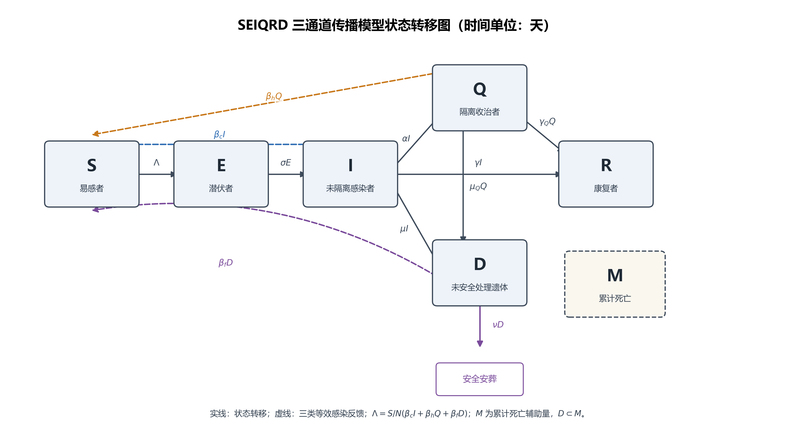

# 第一问：连续时间传播动力学模型的建立

> **研究范围**：本文仅建立连续时间常微分方程数学模型，讨论状态守恒、转移速率、数学观测映射与阈值性质；不涉及实验性生物研究。参数数值留待后续数据分析，不将数学情景解释为已证实的现实效果。

## 1. 模型构建思路

为刻画研究区域内疫情的传播过程，建立由易感、潜伏、未隔离感染、隔离收治、康复和未安全处理的传染性遗体构成的 SEIQRD 六仓室连续时间模型。将新感染过程分为**社区人际传播**、**医院传播**及**葬礼和遗体接触传播**三个等效通道，并通过时变传播系数、隔离收治速率和安全处理速率描述干预措施的动态变化。

这里的“医院传播”是针对总体人群的**等效传播项**，未单独建立医护人员或陪护人员仓室；模型用于总体传播情景分析，不用于预测特定职业人群的感染数量。

## 2. 状态变量

设时间 $t$ 以“天”为单位，六个状态变量分别为：

> 本文全部速率参数统一采用**天$^{-1}$**；代码 `ws/new/code/config.m` 中保留的文献周值按 `日值 = 周值 / 7` 换算后再进入模型，P1/P2 输出表中的单位也均为 `day^-1`。

| 变量 | 含义 | 单位 |
|:---:|---|:---:|
| $S(t)$ | 易感者数量 | 人 |
| $E(t)$ | 潜伏者数量 | 人 |
| $I(t)$ | 有症状但尚未隔离的感染者数量 | 人 |
| $Q(t)$ | 隔离收治者数量 | 人 |
| $R(t)$ | 康复者数量 | 人 |
| $D(t)$ | 尚未安全处理、仍具有传播作用的遗体数量 | 具（计数） |

另设 $M(t)$ 为**累计疾病死亡人数**，$C(t)$ 为模型定义的**累计发病人数**。$M$ 和 $C$ 是观测辅助量，不属于六个相互独立的人群仓室。尤其是 $D$ 已包含在累计死亡 $M$ 中，计算总人口时不能重复相加。固定人口基数 $N$ 指研究起始时对应的**总人口口径**（包括后来进入累计死亡 $M$ 的研究对象），并不是每一时刻的实时存活人口。实时存活人口可另记为 $N_{\mathrm{live}}(t)=S+E+I+Q+R=N-M(t)$；本文感染项暂统一使用固定基数 $N$ 归一化。

## 3. 数学建模假设

1. 在有限研究窗口内，研究总体规模 $N$ 视为常数；暂不显式考虑出生、自然死亡及跨区域人口流动。
2. 用频率依赖的等效接触形式表示传播，各状态内采用均匀混合近似。
3. 潜伏状态 $E$ 不直接产生新感染；$I$、$Q$、$D$ 通过不同系数分别贡献社区、医院及葬礼传播。
4. $Q$ 不参与普通社区传播，其剩余传播作用统一表示为医院等效传播项。
5. 安全处理后的遗体退出 $D$ 仓室；康复者在模型研究期内不重新变为易感者。
6. 隔离、康复和死亡采用非负转移速率。为保持模型精简，康复速率及疾病死亡速率暂设为常数；传染系数、隔离收治速率及安全处理速率允许随时间变化。
7. 初始条件非负，干预函数有界且参数非负，使模型适合进行常微分方程数值模拟。

这些是假设而非已由观测数据证实的事实，使用时应说明以下依据与边界。

**表 1　模型假设的采用理由与适用范围**

| 假设 | 采用理由（数学建模视角） | 适用范围与可能遗漏 |
|---|---|---|
| 研究窗口内固定人口总量 | 便于构造可核验的质量守恒关系，避免额外人口流动参数 | 适用于总体人口变动相对小的短期窗口；不适合直接描述迁入迁出明显的地区 |
| 仓室内部均匀混合 | 将大量个体接触简化为可求解的聚合感染项 | 忽略个体接触网络、地理差异及特殊职业群体 |
| 潜伏状态不计新增感染贡献 | 减少传播通道，保持基础模型的可识别性 | 属于简化假设；如研究资料不支持，应调整模型 |
| 隔离状态只保留等效医院传播项 | 在不新增独立医院人群仓室的前提下，保留第三种传播来源 | 不能直接解释为某一特定医院或职业群体的风险 |
| 遗体经处理后退出传播状态 | 通过单向移出项保证仓室转移闭合 | 不描述处理过程的细部差异与接触网络 |
| 康复者在窗口内不返回易感状态 | 避免引入尚无数据支持的返回通道 | 仅用于该研究窗口内的近似 |
| 状态转移采用非负瞬时速率 | 保证ODE模型的非负性与可解释性 | 对应指数型停留时间；不能自动代表真实的延迟分布 |

### 3.1 状态转移结构图

下图中，**实线为状态间的实际转移**，**虚线为对新增感染项的贡献**；虚线并不表示原状态中的人数直接移入另一状态。累计死亡量 $M$ 为辅助统计量，已包含当前遗体仓室 $D$ 对应的人数，故图中不将二者作为互斥人群状态。

*图1　SEIQRD连续时间模型的状态转移及三类等效感染反馈（本研究绘制）。*

## 4. 三途径感染项

定义社区、医院和葬礼传播导致的单位时间新增感染量：

$$
\begin{aligned}
\Lambda_c(t)&=\beta_c(t)\frac{S(t)I(t)}{N},\\
\Lambda_h(t)&=\beta_h(t)\frac{S(t)Q(t)}{N},\\
\Lambda_f(t)&=\beta_f(t)\frac{S(t)D(t)}{N}.
\end{aligned}
$$

其中 $\beta_c(t)$、$\beta_h(t)$ 和 $\beta_f(t)$ 分别为社区、医院和葬礼传播的**等效传播系数**。总新增感染量为：

$$
\boxed{\Lambda(t)=\frac{S(t)}{N}\big[\beta_c(t)I(t)+\beta_h(t)Q(t)+\beta_f(t)D(t)\big]}
\tag{1}
$$

若需定义每名易感者对应的感染压力，可写为：

$$
\lambda(t)=\frac{\beta_c(t)I(t)+\beta_h(t)Q(t)+\beta_f(t)D(t)}{N},
\qquad \Lambda(t)=\lambda(t)S(t).
$$

**注意**：$\Lambda$ 为新增感染量（人/天），$\lambda$ 为单位易感者感染压力（天$^{-1}$），二者不应混用。

## 5. 连续时间状态方程

各仓室遵循“流入量减流出量”原则，得到：

$$
\boxed{\begin{aligned}
\frac{dS}{dt}&=-\Lambda(t),\\
\frac{dE}{dt}&=\Lambda(t)-\sigma E,\\
\frac{dI}{dt}&=\sigma E-[\alpha(t)+\gamma+\mu]I,\\
\frac{dQ}{dt}&=\alpha(t)I-(\gamma_Q+\mu_Q)Q,\\
\frac{dR}{dt}&=\gamma I+\gamma_Q Q,\\
\frac{dD}{dt}&=\mu I+\mu_Q Q-\nu(t)D.
\end{aligned}}
\tag{2}
$$

其中 $\sigma$ 为潜伏状态转入未隔离感染状态的速率；$\alpha(t)$ 为隔离收治速率；$\gamma,\gamma_Q$ 为对应康复速率；$\mu,\mu_Q$ 为对应疾病死亡速率；$\nu(t)$ 为传染性遗体的安全处理速率。

### 5.1 转移速率、转移概率与平均停留时间的区别

模型的 $\alpha,\gamma,\mu$ 均为**单位时间内的瞬时转移速率**（单位：天$^{-1}$），不是直接的转移概率；$1/\alpha$ 也不能直接等同于存在康复、死亡竞争风险时观测到的平均入院时间。

在固定参数条件下，令 $a=\alpha+\gamma+\mu>0$，从 $I$ 状态离开的平均停留时间为

$$
\mathbb{E}[T_I]=\frac{1}{a}.
\tag{2a}
$$

首次离开 $I$ 时，三种互斥转移的概率为

$$
P(I\to Q)=\frac{\alpha}{a},\qquad
P(I\to R)=\frac{\gamma}{a},\qquad
P(I\to D)=\frac{\mu}{a}.
\tag{2b}
$$

令 $b=\gamma_Q+\mu_Q>0$，从进入 $I$ 开始计算，模型给出的最终死亡概率为

$$
p_{\mathrm{death}}=\frac{\mu}{a}+\frac{\alpha}{a}\frac{\mu_Q}{b}.
\tag{2c}
$$

上述概率解释依赖于**固定转移速率及指数停留时间假设**。对时变参数情形，不应直接套用固定速率下的竞争风险概率。

累计死亡人数的辅助方程为：

$$
\boxed{\frac{dM}{dt}=\mu I+\mu_QQ.}
\tag{3}
$$

在“进入 $I$ 即计入模型累计病例”的口径下，定义：

$$
C(t)=I(t)+Q(t)+R(t)+M(t),
$$

因此有：

$$
\boxed{\frac{dC}{dt}=\sigma E.}
\tag{4}
$$

**观测口径提示**：$C(t)$ 是模型意义下的累计发病量，不自动等于实际报告的累计确诊数。为便于下一问使用逐日新增病例及累计报告量，给出最简观测映射。

令第 $k$ 个观测区间为 $[t_{k-1},t_k]$，$Y_k^{(C)}$ 为该区间**报告新增病例数**，$Y_k^{(M)}$ 为报告新增死亡数，报告比例分别为 $\rho_C(t),\rho_M(t)\in[0,1]$，则在不考虑报告延迟的近似下：

$$
\begin{aligned}
\mathbb{E}[Y_k^{(C)}]&=\int_{t_{k-1}}^{t_k}\rho_C(t)\sigma E(t)\,dt,\\
\mathbb{E}[Y_k^{(M)}]&=\int_{t_{k-1}}^{t_k}\rho_M(t)[\mu I(t)+\mu_Q Q(t)]\,dt.
\end{aligned}
\tag{4a}
$$

相应的报告累计值为起始报告累计数加上逐区间新增报告量之和。**若采用完全报告近似**，则取 $\rho_C(t)=\rho_M(t)=1$；若需考虑报告延迟，应另定义延迟核并对真实新增曲线做卷积，不能在不说明的情况下将模型累计量与报告累计量直接等同。

这里仅给出可用于数值拟合的数学观测结构，**不在第一问拟合报告比例、延迟或新增传播参数**，以避免重复解释同一组数据。

## 6. 时变参数与干预函数

设社区、医院和葬礼三类传播的无干预基准系数分别为 $\beta_{c0},\beta_{h0},\beta_{f0}$。令 $u_c(t),u_h(t),u_f(t)\in[0,1]$ 表示对应通道的相对削减强度，则：

$$
\begin{aligned}
\beta_c(t)&=\beta_{c0}[1-u_c(t)],\\
\beta_h(t)&=\beta_{h0}[1-u_h(t)],\\
\beta_f(t)&=\beta_{f0}[1-u_f(t)].
\end{aligned}
\tag{5}
$$

令 $u_\alpha(t),u_\nu(t)\in[0,1]$ 表示隔离与安全处理措施的相对强化程度，取：

$$
\begin{aligned}
\alpha(t)&=\alpha_0+\Delta\alpha\,u_\alpha(t),\\
\nu(t)&=\nu_0+\Delta\nu\,u_\nu(t),
\end{aligned}
\tag{6}
$$

其中 $\Delta\alpha\geq 0$、$\Delta\nu\geq 0$。这样，各措施可以单独或组合调整，并保持参数非负。

为了使模型容易估计和实现，首先采用分段常数干预函数：

$$
\boxed{u_j(t)=\begin{cases}
0,&t<t_j,\\
\bar u_j,&t\geq t_j.
\end{cases}}
\tag{7}
$$

其中 $t_j$ 为实施时刻，$\bar u_j\in[0,1]$ 为实施后的强度。不同措施可有不同的实施时刻。若以后需要表达渐进式实施，也可以将分段函数替换为连续的 Logistic 函数，但不是建立基础模型的必要条件。

## 7. 参数说明

| 参数 | 含义 | 单位 |
|:---:|---|:---:|
| $\beta_c(t)$ | 时变社区传播系数 | 天$^{-1}$ |
| $\beta_h(t)$ | 时变医院等效传播系数 | 天$^{-1}$ |
| $\beta_f(t)$ | 时变葬礼传播系数 | 天$^{-1}$ |
| $\sigma$ | 潜伏者转为有症状感染者的速率 | 天$^{-1}$ |
| $\alpha(t)$ | 隔离收治速率 | 天$^{-1}$ |
| $\gamma,\gamma_Q$ | 未隔离、隔离患者的康复速率 | 天$^{-1}$ |
| $\mu,\mu_Q$ | 未隔离、隔离患者的疾病死亡速率 | 天$^{-1}$ |
| $\nu(t)$ | 遗体安全处理速率 | 天$^{-1}$ |
| $u_j(t)$ | 第 $j$ 类措施的干预强度 | 无量纲 |
| $N$ | 研究区域人口规模 | 人 |

本模型仅规定参数的结构与含义；具体数值和置信区间应由后续参数拟合、外部资料约束或情景敏感性分析给出。

### 7.1 参数分组与可识别性原则

仅凭病例与死亡两类总量序列，难以让所有时变系数自由变化。为保证后续拟合问题可解，采用以下**参数分组原则**，而不预设实际参数数值：

| 参数层级 | 处理原则 | 目的 |
|---|---|---|
| 固定或受较强约束的参数 | 对 $\sigma,\gamma,\gamma_Q$ 等优先给定有依据的固定值或窄范围 | 降低参数维数，保留基础转移结构 |
| 少量需要拟合的参数 | 先拟合少量综合传播强度或少数分段阶段参数，避免三条通道同时任意变化 | 减少不可辨识的自由度 |
| 情景比较参数 | 将分通道贡献或额外变化幅度作为受约束的情景输入，不声称均由总量数据独立识别 | 为后续模型比较保留接口 |
| 报告参数 | 缺少额外报告数据时，先固定 $\rho_C,\rho_M$ 或采用少数受约束的常数 | 避免报告率变化与传播率变化相互混淆 |

**识别性检查**可在下一问进行：比较多组初值获得的拟合参数、查看残差与参数相关性，并报告不同合理约束下主要数学结论是否稳定。第一问不需要预先承诺每个传播通道都能被数据独立识别。

## 8. 基本再生数的数学推导

对固定参数情景，在无病平衡点附近取感染相关状态：

$$X=(E,I,Q,D)^{\mathsf T}.$$

令：

$$a=\alpha+\gamma+\mu,\qquad b=\gamma_Q+\mu_Q.$$

采用下一代矩阵法，新感染矩阵和状态转移矩阵分别为：

$$
F=\begin{pmatrix}
0&\beta_c&\beta_h&\beta_f\\
0&0&0&0\\
0&0&0&0\\
0&0&0&0
\end{pmatrix},\qquad
V=\begin{pmatrix}
\sigma&0&0&0\\
-\sigma&a&0&0\\
0&-\alpha&b&0\\
0&-\mu&-\mu_Q&\nu
\end{pmatrix}.
$$

下一代矩阵为 $K=FV^{-1}$，基本再生数为其谱半径：

$$R_0=\rho(K).$$

计算可得：

$$
\boxed{
R_0=\frac{\beta_c}{a}
+\frac{\alpha\beta_h}{ab}
+\frac{\beta_f}{\nu}
\left(\frac{\mu}{a}+\frac{\alpha\mu_Q}{ab}\right)
}
\tag{8}
$$

将其分解为：

$$
R_0=\underbrace{\frac{\beta_c}{a}}_{R_c}
+\underbrace{\frac{\alpha\beta_h}{ab}}_{R_h}
+\underbrace{\frac{\beta_f}{\nu}\left(\frac{\mu}{a}+\frac{\alpha\mu_Q}{ab}\right)}_{R_f}.
$$

此处 $R_c,R_h,R_f$ 分别是三个等效传播通道对固定参数模型再生数的贡献。该阈值结论需写明所在线性化平衡状态和适用条件。这里的系统**没有补充易感人口的出生流入项**，因此存在一族无病平衡状态：$E=I=Q=D=0$，$S=S^*$（其余累计量满足守恒）。

在固定参数、$\sigma>0$、$a=\alpha+\gamma+\mu>0$、$b=\gamma_Q+\mu_Q>0$、$\nu>0$，以及非负传播系数的条件下：

- 在**完全易感状态** $S^*=N$ 附近，$R_0<1$ 对应感染子系统的线性衰减，$R_0>1$ 表示感染扰动具有初始增长能力；$R_0=1$ 是临界情形，需单独分析。
- 若讨论的是易感人口为 $S^*<N$ 的某个无病状态，相应入侵阈值为

$$
\mathcal R_{\mathrm{inv}}(S^*)=\frac{S^*}{N}R_0.
\tag{8a}
$$

因此不能不加限定地说“$R_0<1$ 时任意无病平衡点都局部渐近稳定”。在没有人口补充的模型里，无病平衡状态沿易感/累计方向通常并非孤立点；严格的稳定性叙述应针对**感染子系统的横向线性稳定性**。

## 9. 时变参数下的瞬时有效再生数

对于随时间变化的系数，定义：

$$a(t)=\alpha(t)+\gamma+\mu,\qquad b=\gamma_Q+\mu_Q.$$

将每个时刻的参数暂时视为常数（冻结参数近似），并考虑易感人口比例，得到：

$$
\boxed{\begin{aligned}
R_{\mathrm{eff}}(t)=\frac{S(t)}{N}\Bigg[
&\frac{\beta_c(t)}{a(t)}
+\frac{\alpha(t)\beta_h(t)}{a(t)b}\\
&+\frac{\beta_f(t)}{\nu(t)}
\left(\frac{\mu}{a(t)}+\frac{\alpha(t)\mu_Q}{a(t)b}\right)
\Bigg].
\end{aligned}}
\tag{9}
$$

该指标适用于比较各时点的传播强度，是**瞬时/冻结参数近似指标**，不等同于快速变化的非自治系统的严格全局阈值。

## 10. 初始条件、守恒关系与数值解法

设初始条件为：

$$
\begin{gathered}
S(0)=S_0,\ E(0)=E_0,\ I(0)=I_0,\\
Q(0)=Q_0,\ R(0)=R_{\mathrm{init}},\ D(0)=D_0,\ M(0)=M_0.
\end{gathered}
$$

这里 $R_{\mathrm{init}}$ 是初始康复人数，不与再生数 $R_0$ 混淆。根据累计死亡计数与遗体仓室的关系：

$$
\boxed{N=S_0+E_0+I_0+Q_0+R_{\mathrm{init}}+M_0.}
\tag{10}
$$

此外，应补充相容初始约束 $0\le D_0\le M_0$，表示初始未安全处理遗体是累计死亡的一部分；同时 $S_0,E_0,I_0,Q_0,R_{\mathrm{init}},M_0\ge0$，且它们的和为 $N$。

由方程 (2)–(3) 可直接验证：

$$
\frac{d}{dt}(S+E+I+Q+R+M)=0.
$$

注意：不能再额外将 $D$ 加入上述总人口守恒式，因为它是累计死亡 $M$ 的一部分。还可由式 (2)–(3) 验证：

$$
\frac{d}{dt}(M-D)=\nu(t)D\ge0.
\tag{10a}
$$

因此若初始 $0\le D_0\le M_0$，则后续始终有 $0\le D(t)\le M(t)$。在非负、有界的转移系数下，任一状态达到零的边界时，其方程右端不会使它继续向负数方向变化，故非负正交域保持不变。以上守恒性、相容性与非负性均可在MATLAB数值求解后用误差检查复核。

模型一般没有便于直接使用的闭式解析解，可以采用 MATLAB 的 `ode45` 或 `ode15s` 进行数值积分。若干预函数采用分段常数，应在各干预变点分别积分，并将上一段终值作为下一段初值，以保证仓室状态连续。

数值输出包括 $S,E,I,Q,R,D$ 的变化曲线、累计发病 $C$、累计死亡 $M$ 和 $R_{\mathrm{eff}}(t)$，用于后续参数拟合及干预情景对比。

## 11. 模型适用范围与后续工作

该模型适用于**总体层面的数学传播模拟**，并以可解释的少量参数表示多类传播途径和干预措施。由于新增了社区、医院和葬礼三个传播系数，仅凭累计病例与累计死亡两类观测通常难以稳定识别所有参数。后续应对参数进行可识别性检查，必要时施加比例约束、固定部分参数，或使用额外观测与情景分析。

**数值校验（2026-11-19）**：在 `ws/new/code/task1_checks.m` 中，legacy 两通道模型的公式值与旧输出一致（`R0=1.355789887/0.884312117`）；新版三通道模型的闭式 `R0` 与下一代矩阵数值谱半径一致（早期 `1.341443500`、后期 `1.142720773`）；三条通道贡献非负，速率单位均为天$^{-1}$。6/6 检查通过，结果见 `ws/new/outputs/task1/T1_checks.csv` 与 `T1_R0_regression.csv`。

**本问建立的数学模型包括：式 (1) 的三类感染贡献、式 (2)–(4a) 的动力学与观测方程、式 (5)–(7) 的动态参数表示、式 (8)–(9) 的局部阈值指标，以及式 (10)–(10a) 的人口守恒和状态相容约束。后续拟合与情景结果应分别报告，不在本问预设。**
